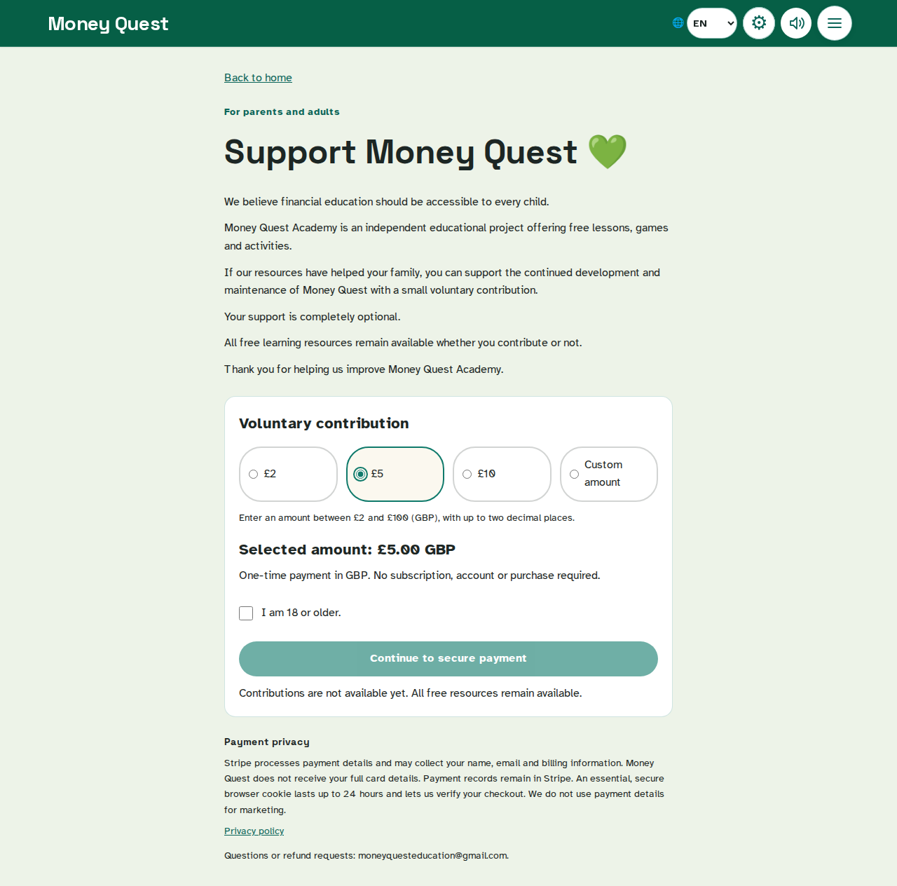
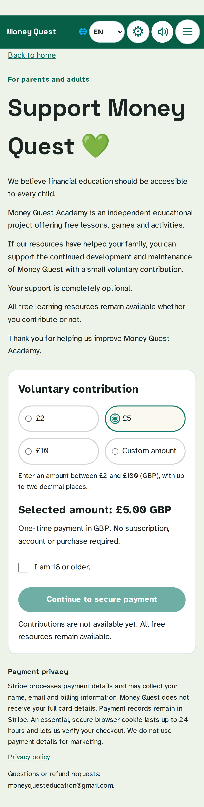

# Voluntary support: review implementation

Status: sandbox-only code; owner has since authorized continuation through live launch. Staging was deployed on 17 November 2026. Production is not yet updated. Production payments cannot be enabled by setting an environment variable: the server rejects every live key and any mode other than `sandbox`. A separate reviewed change is required after owner approval.

## Repository and Stripe inspection (16 November 2026)

Based on main `0486170`, which already uses Next.js 15.5.28, Node 24.22.1 and Stripe 23.1.0. Open PRs inspected: #59 (auditor), #49 (Explorer styling), #45 (journal archive), #25/#24 (printables), #21 (currency), #12 (commerce audit). Remote branch inventory inspected; no existing support implementation found. No other branches changed.

Initially connected account: Money Quest, `acct_1UVYX9QZFq5acwqx`, live access only. During review, the owner also connected `Money Quest sandbox`, `acct_1UVTeNHDC3WzcjKr`, with `livemode=false`. The sandbox now contains one support product, `prod_MQVoluntarySupportV1`, reused for all amounts. Existing shop products remain unchanged and no payment links were created. Existing live webhook points to `/api/shop/webhook` for completed and asynchronously successful Checkout Sessions. No live object, webhook, price, credential or account setting was changed.

`checkoutPaused()` defaults to true unless `MONEYQUEST_CHECKOUT_PAUSED=false`. This feature does not change that flag, shop navigation, product availability or fulfillment. Keep it absent or explicitly true. Support never imports the shop configuration, downloads or fulfillment. It reuses the installed Stripe SDK, body size guard, checkout URL validator, locale routing and design tokens.

## Flow

- Localized `/support` (middleware redirects the bare path to a language) and `/support/success`.
- Discreet links only on the homepage parent section and Parent Resources. No global learning navigation changes.
- £2, £5, £10, or £2–£100 custom GBP amount; decimal comma or point accepted. Integer pence validation on the server, adult checkbox, fixed currency, quantity one, payment mode only. No account or subscription.
- One reusable support product identified by `metadata.app=moneyquest-voluntary-support-v1`. Checkout `price_data` creates the requested one-time amount. No need for four separate products or public payment links; user amounts cannot select shop products.
- CSRF origin check, 1 KB body cap, bounded process-wide and browser rate limits (30/minute and 5/minute). Global limit still applies to rotating cookies and spoofed IP headers. Limits reset on process restart and multiply with workers; before any live release, confirm single worker or move limits into shared storage/reverse proxy. Stripe fraud controls also need review.
- Stable Stripe idempotency key on retries; the browser token is set even when Stripe times out. Inputs are locked during submission. A changed amount starts a new attempt.
- HTTP-only SameSite=Lax cookie binds the return page to the paying browser. Success requires a server retrieval: correct support metadata, test environment, one-time GBP amount, exact product/quantity, settled intent and no refund or dispute. Arbitrary success URLs and failed/pending payments cannot produce success text. No customer details are sent to the page.
- Dedicated signed `/api/support/webhook` receives completed, asynchronously successful and failed events. It retrieves/validates paid sessions. Stripe remains the payment ledger. There are no local entitlements, emails or fulfillment side effects, so duplicate events are idempotent. Transient retrieval failures return 500 for Stripe retry; unrelated and unpaid events are acknowledged without confirmation.
- Support pages are excluded from offline downloads. The return page is dynamic, non-indexable and uses a no-referrer policy.

## Sandbox setup and verified staging results

The owner confirmed they do not collect VAT. Sandbox product `prod_MQVoluntarySupportV1` is configured with automatic tax disabled. Four actual Checkout Sessions were created for £2, £5, £10 and £2.50, all one-time GBP and livemode=false. The £2 hosted checkout was completed using Stripe's fictitious 4242 test card. Stripe subsequently confirmed status=complete and payment_status=paid, PaymentIntent `pi_3UcflTHDC3WzcjKr1kSNziPD`. No real money moved.

Staging is installed at https://staging.moneyquesteducation.com/en/support. The existing sandbox key and dedicated signing secret are configured securely in Namecheap, with the sandbox mode/product and staging origin. Endpoint `we_1Uckp6HDC3WzcjKr3fizIlUj` targets the independent support webhook.

An application-created £2 checkout succeeded on 17 November: session `cs_test_a0GkN0RYBBoceTpARivquvM6hhH4HBtbaFwxuNCmABtth4pCS1FuWb7sET`, intent `pi_3UcpUAHDC3WzcjKr09medEKL`. The browser returned to the application and displayed its server-verified confirmation. Event `evt_1UcpUBHDC3WzcjKroodfl0Dn` delivered HTTP 200 with received=true and verified=true. The £5 cancellation returned safely without a success claim. £2.50 custom checkout displayed the correct amount. On 18 November, an app-created £10 checkout displayed the correct amount; Stripe declined the designated fictitious decline card and cancellation again displayed no payment confirmation. No real funds moved.

The owner subsequently requested an adult gate. Its new code is not yet deployed to staging. It hides the support content and amounts until a randomly generated multiplication question and adult declaration are completed. An HTTP-only signed proof expires after three minutes and the checkout endpoint independently enforces it. Incorrect/expired/tampered proofs fail closed. This is an accidental-access barrier, not proof of age or a guarantee that an older child cannot solve the question. No parent email, account or personal information is collected for the gate. Dedicated consent tests and browser journeys cover all nine languages. Authentication/delayed/refund scenarios remain unverified with actual Stripe payments.

1. Reuse `prod_MQVoluntarySupportV1` in this sandbox. For future environments, list products by `metadata.app=moneyquest-voluntary-support-v1`. Reuse exactly one match; if none, create one product named `Support Money Quest`, description `One-time voluntary contribution to an independent educational project. No goods or additional access are supplied.`, with that metadata. No duplicate product or payment link is needed.
2. Store a restricted test key in the hosting/CI secrets configuration, never in git or chat. Permissions: products read; Checkout Sessions write/read; PaymentIntents and Charges read (including expansion). Verify permissions with the test suite before live approval.
3. Set `MONEYQUEST_SUPPORT_MODE=sandbox`, `MONEYQUEST_SUPPORT_STRIPE_KEY` (test restricted key), `MONEYQUEST_SUPPORT_PRODUCT_ID` (the sandbox product), and `MONEYQUEST_SUPPORT_WEBHOOK_SECRET` (the dedicated endpoint signing secret). Existing `MONEYQUEST_STRIPE_KEY` can be reused only if it is a test key; live credentials are deliberately rejected and must not be replaced.
4. Set `NEXT_PUBLIC_SITE_URL` to the staging HTTPS origin, or `http://localhost:3000` locally. Register a sandbox webhook for `/api/support/webhook` with `checkout.session.completed`, `checkout.session.async_payment_succeeded`, `checkout.session.async_payment_failed`. Locally forward those events with Stripe CLI. Keep the existing shop endpoint and secret unchanged.
5. Run actual Stripe-hosted tests for £2, £5, £10 and £2.50; cancel, decline, required authentication, delayed payment, duplicate webhook, and refund. Check settled results in Stripe and confirm return-page browser ownership. Do not mark these tests passed based on mocks.

No live setup is included in this PR. Before future activation, owner approval is required for the code gate, live product/key/webhook, merge and deployment.

## Owner decisions before launch

Money Quest is an independent educational project, not a registered charity. These contributions provide no goods, services, special access, Gift Aid or promised tax relief.

- Confirm the legal recipient/trading name, business status, geographic contact address and applicable registration/VAT details. Do not invent or publish personal account details inferred from Stripe. Confirm statement descriptor and receipt contact information.
- Confirm treatment of voluntary receipts with HMRC/an accountant, including income reporting and records. Voluntary does not automatically mean tax-free. Confirm whether the payment is genuinely unconditional and outside VAT, or whether VAT registration/treatment applies; this implementation does not collect VAT and is not a tax determination.
- Confirm refund handling, mistaken payments and any applicable consumer cancellation/disclosure requirements. No blanket non-refundable claim or cancellation waiver is included.
- Complete privacy/controller disclosures: legal identity/contact, processing basis, recipients/Stripe international transfers, retention of accounting/payment records and access/deletion rights, complaint route and applicable ICO registration. The nine-language payment paragraph explains Stripe processing, the essential cookie and no marketing, but is not a substitute for those owner-specific disclosures.
- Confirm Stripe permits this account's contribution activity, account verification, payment methods, fraud controls and receipt settings.

Primary references checked on 16 November 2026:

- [HMRC: voluntary receipts](https://www.gov.uk/hmrc-internal-manuals/business-income-manual/bim41801)
- [HMRC: freely given payments and VAT](https://www.gov.uk/hmrc-internal-manuals/vat-supply-and-consideration/vatsc06110)
- [UK distance selling disclosures](https://www.gov.uk/online-and-distance-selling-for-businesses)
- [Electronic Commerce Regulations, regulation 6](https://www.legislation.gov.uk/uksi/2002/2013/body/2026-05-07)
- [ICO: privacy information](https://ico.org.uk/for-organisations/uk-gdpr-guidance-and-resources/individual-rights/individual-rights/right-to-be-informed/)
- [Stripe Checkout](https://docs.stripe.com/payments/checkout)
- [Stripe webhook fulfillment](https://docs.stripe.com/checkout/fulfillment)

## Tests and review evidence

`npm run test:unit` automatically discovers `scripts/test-support-payments.ts`. It checks parsing, tampering, the sandbox gate, settlement/refund rejection, browser ownership, stable retry payloads, rate limits, shop pause and nine-language key coverage using a fake Stripe client. This is not an actual Stripe test payment.

`e2e/journeys/support.spec.ts` covers all nine locales, custom amounts, layout overflow, parent links, cancellation, false-success prevention, API closed states, absence on the learning hub, keyboard radio navigation and axe accessibility. It saves desktop/mobile (and CI Safari) screenshots in `docs/support/screenshots/`. The existing quality workflow runs these tests and uploads screenshots with its evidence. Optional `PLAYWRIGHT_CHROMIUM_EXECUTABLE` allows the installed system Chromium locally.

See the PR for the actual run results and remaining Stripe access blocker.

### Broad-suite blocker observed

Historical run [43906993495](https://github.com/laviniamoraru28-creator/money-quest/actions/runs/43906993495) passed lint, types, all unit suites, certificate QA, build and package rehearsal. The existing broad browser suite recorded 290 passed, 8 failed, 1 interrupted, 11 skipped and 828 not run before its failure limit. Failures are in `lesson-illustrations.spec.ts`, `lesson-sequence-integrity.spec.ts`, and `owner-navigation-search.spec.ts`, expecting pre-comic Explorer money-form controls/artwork. This feature does not modify those lesson implementations or tests. That run was superseded by run 44128085648 after merging main QA updates: lint, types, 64 unit suites, build, packaging, Chromium, iPhone/iPad and additional iPad journeys all passed. The new adult-gate revision needs its own CI result.

The existing quality workflow now runs the support suite on desktop/mobile Chromium and iPhone/iPad WebKit before the broad suite, and uploads a small standalone screenshot artifact. This ensures unrelated broad-suite failures cannot prevent support review evidence. The broad Chromium suite excludes those exact already-run support tests.

Additional local HTTP checks passed for all nine support routes (200), closed shop/support APIs (503), forged success URLs, and synthetic sandbox configuration rejection of foreign origins, invalid amounts, missing adult confirmation, extra fields, oversized requests and invalid webhook signatures. No Stripe API request or real/test charge was made by those HTTP checks. The browser build contains no Stripe secret configuration strings. Offline manifests contain zero support routes.

### Support-specific browser verification

Run [43909522722](https://github.com/laviniamoraru28-creator/money-quest/actions/runs/43909522722) passed the dedicated support review step: 44 tests across desktop Chromium, Pixel 7 Chromium, iPhone 13 WebKit and iPad Mini WebKit. All nine language routes, amount selection, optional/closed payment state, cancellation, unverified success, shop pause, keyboard navigation, overflow and axe checks passed. These checks do not constitute Stripe-hosted payment tests. Desktop and mobile screenshots were visually inspected; there is no clipped content or horizontal overflow.

Screenshots are from the disabled, pre-launch review state, with £5 selected by the keyboard-navigation test:

[Additional iPhone screenshot](screenshots/iphone-safari.png) · [Additional iPad screenshot](screenshots/tablet-safari.png)
